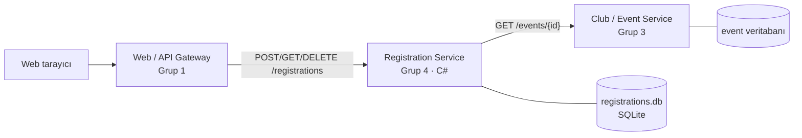
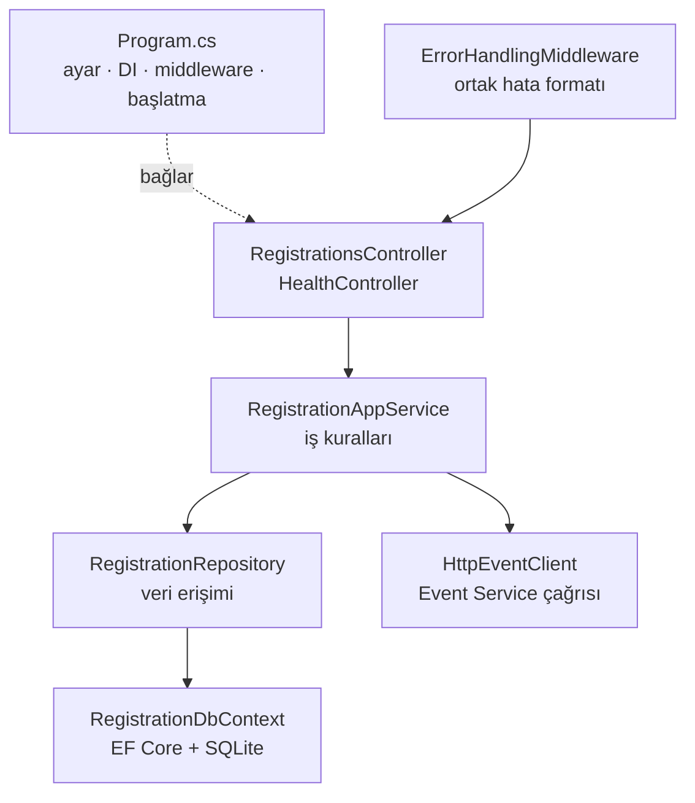
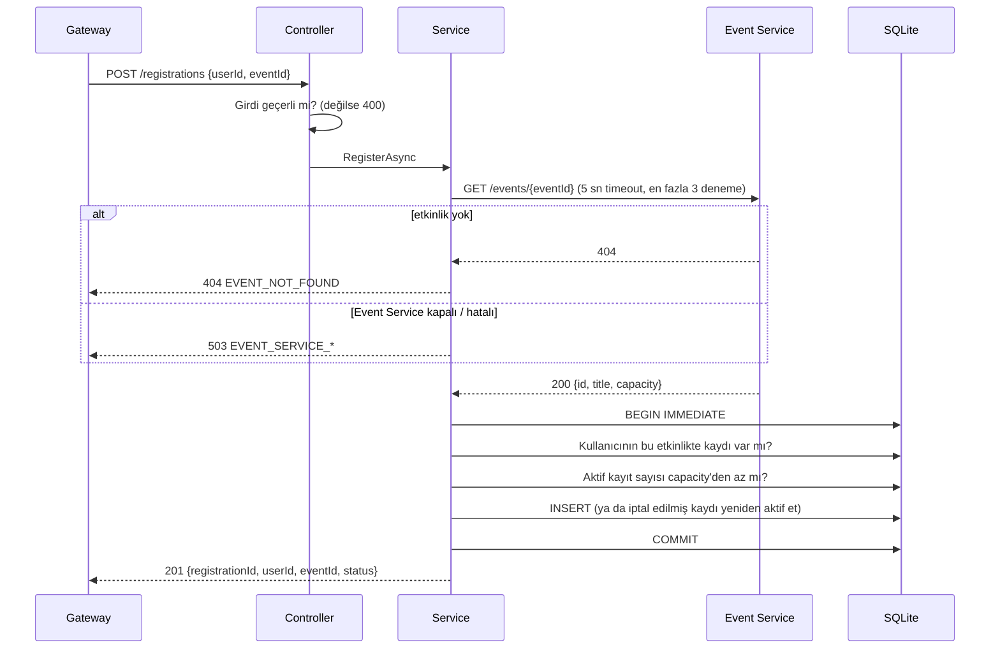

# Registration Service – Mimari (Grup 4)

CampusHub'da kullanıcıların etkinliklere kayıt olması, kayıtların listelenmesi ve iptal edilmesi bu servisin işidir. Servis C# / ASP.NET Core 8 ile yazıldı ve kendi SQLite veritabanını kullanır.

Diğer gruplar için API ayrıntıları: [api-contract.md](api-contract.md).

## 1. Sistemdeki yeri



Kapsamın temel kuralına (madde 6) uyulur: Registration Service Event Service'in veritabanına **erişmez**, etkinlik bilgisini yalnızca `GET /events/{id}` ile alır. Kendi veritabanına da başka servis erişmez.

## 2. Katmanlar



| Katman | Dosya | Sorumluluk |
|---|---|---|
| Başlatma | `Program.cs` | Ortam değişkenlerini okur, bileşenleri dependency injection ile bağlar, veritabanını oluşturur, sunucuyu başlatır. İş mantığı içermez (kapsam 26–27). |
| Controller | `Controllers/` | HTTP isteğini alır, girdiyi doğrular, servisi çağırır, durum kodunu döner. |
| Service | `Services/RegistrationService.cs` | Kayıt kuralları: etkinlik var mı, zaten kayıtlı mı, kapasite dolu mu, iptal/yeniden kayıt. |
| Event istemcisi | `Services/HttpEventClient.cs` | Event Service'e HTTP çağrısı, timeout ve retry, hata durumlarını kendi hata kodlarımıza çevirme. |
| Repository | `Repositories/` | Veritabanı sorguları ve transaction. Service katmanı EF Core'u doğrudan görmez. |
| Veri | `Data/`, `Models/` | Tablo tanımı, indeksler. |
| DTO | `Dtos/` | API'nin istek/cevap nesneleri ve ortak hata formatı. |
| Hata | `Exceptions/`, `Middleware/` | Uygulama hataları (`NotFoundException` → 404 vb.) ve hepsini tek formatta döndüren middleware. |

Her katman bir **interface** üzerinden kullanılır (`IRegistrationService`, `IRegistrationRepository`, `IEventClient`). Testlerde gerçek Event Service yerine `FakeEventClient` bu sayede takılabiliyor.

## 3. Kayıt akışı (`POST /registrations`)



HTTP çağrısı transaction'ın **dışında** yapılır, böylece Event Service yavaşken veritabanı kilitli kalmaz.

## 4. Veri modeli

Tablo: `Registrations`

| Alan | Tip | Not |
|---|---|---|
| `Id` | int | Birincil anahtar (`registrationId`) |
| `UserId` | int | Auth Service'teki kullanıcı id'si (o servise sorulmaz) |
| `EventId` | int | Event Service'teki etkinlik id'si |
| `Status` | metin | `REGISTERED` / `CANCELLED` |
| `CreatedAt` | tarih | UTC |
| `CancelledAt` | tarih, boş olabilir | İptal zamanı |

- `(UserId, EventId)` üzerinde **unique indeks**: aynı kullanıcı aynı etkinliğe veritabanı seviyesinde de iki kez yazılamaz.
- `EventId` üzerinde indeks: kapasite sayımı hızlı olsun diye.
- İptal kaydı silmez, `Status`'u `CANCELLED` yapar. Aynı kullanıcı tekrar kayıt olursa aynı satır yeniden `REGISTERED` olur.

## 5. Hata yönetimi

Servis katmanı hataları **exception** olarak fırlatır; `ErrorHandlingMiddleware` bunları yakalayıp kapsamdaki ortak formatta döner:

```json
{ "error": "EVENT_FULL", "message": "Event 31 is full." }
```

| Exception | HTTP | Örnek kodlar |
|---|---|---|
| `BadRequestException` | 400 | `INVALID_INPUT` |
| `NotFoundException` | 404 | `EVENT_NOT_FOUND`, `REGISTRATION_NOT_FOUND` |
| `ConflictException` | 409 | `ALREADY_REGISTERED`, `EVENT_FULL`, `ALREADY_CANCELLED` |
| `ServiceUnavailableException` | 503 | `EVENT_SERVICE_UNAVAILABLE`, `EVENT_SERVICE_ERROR`, `EVENT_SERVICE_INVALID_RESPONSE` |
| Diğer her şey | 500 | `INTERNAL_ERROR` (loglanır, servis çökmez) |

## 6. Dayanıklılık (kapsam madde 37–38)

| Beklenti | Nasıl sağlandı |
|---|---|
| Servis çalışmıyorsa uygun hata mesajı | Event Service kapalıysa 503 `EVENT_SERVICE_UNAVAILABLE` |
| Sonsuz bekleme yok | Her deneme 5 sn timeout; en fazla 3 deneme (100 ms, 200 ms ara) → en kötü ~15 sn |
| Geçici hatalarda tekrar deneme | 5xx, 408, 429, bağlantı hatası ve timeout'ta retry; 404 ve bozuk JSON'da retry yok |
| Yanlış input → 400 | `userId`/`eventId` ≥ 1 olmalı, bozuk JSON da 400 |
| Olmayan kayıt → 404 | `REGISTRATION_NOT_FOUND`, `EVENT_NOT_FOUND` |
| Aynı etkinliğe iki kez kayıt engellenir | Servis kontrolü + transaction + unique indeks (üç katman) |
| Servis beklenmeyen durumda çökmez | Middleware her exception'ı yakalar, 500 döner |

**Eşzamanlı istekler:** Kontrol + kayıt adımları tek transaction'da çalışır. SQLite'ta EF Core transaction'ı `BEGIN IMMEDIATE` ile başlar; ikinci istek ilki bitene kadar bekler. Böylece son 1 yer kalmışken iki kişi aynı anda kayıt olamaz. Bu davranış `EsZamanliKayitTests` ile test edilir (kapasitesi 1 olan etkinliğe 10 eşzamanlı istek → tam 1 kayıt).

## 7. Çalıştırma ve dağıtım

| Ortam değişkeni | Varsayılan (Docker) |
|---|---|
| `PORT` | `8004` |
| `DB_PATH` | `/app/data/registrations.db` |
| `EVENT_SERVICE_URL` | `http://event-container:8002` |

- **Dockerfile:** İki aşamalı (SDK ile derle → sadece ASP.NET runtime ile çalıştır), root olmayan `app` kullanıcısı, `/health`'i kontrol eden `HEALTHCHECK`, veritabanı `/app/data` volume'unda.
- **Lokal deneme:** `docker compose up -d --build` servisi nginx ile yazılmış **sahte bir Event Service** ile birlikte başlatır (Grup 3 hazır olmadan uçtan uca test için).
- **Entegrasyon:** `campushub-integration` compose tanımı [api-contract.md](api-contract.md#6-entegrasyon-compose-tanımı) içinde.

## 8. Test stratejisi

xUnit ile 38 test, `tests/RegistrationService.Tests` altında:

| Sınıf | Ne test eder |
|---|---|
| `RegistrationAppServiceTests` | İş kuralları (kayıt, 404, 409, kapasite, iptal, yeniden kayıt, 503) |
| `HttpEventClientTests` | Event Service cevaplarına göre davranış (200, 404, 500, bozuk JSON, bağlantı hatası, timeout) |
| `ApiTests` | Servis bellekte ayağa kaldırılıp gerçek HTTP istekleriyle: durum kodları, filtreler, hata formatı |
| `RegistrationRepositoryTests` | Unique indeks ihlali → 409, transaction geri alma |
| `EsZamanliKayitTests` | Eşzamanlı isteklerde kapasite aşılmaması ve çift kayıt olmaması |

Testler dış servise bağlanmaz: Event Service yerine `FakeEventClient`, veritabanı olarak bellekte SQLite kullanılır.

## 9. Geliştirme süreci

```
feature branch → Pull Request → CI (test + docker build) → review (1 onay) → merge → main
```

- `main` korumalı: doğrudan push yok, PR için 1 onay ve yeşil CI (`test`) zorunlu, kuralı admin de atlayamaz.
- CI (`.github/workflows/ci.yml`) her PR'da testleri çalıştırır, Docker imajını derler ve güncel OpenAPI dokümanını artifact olarak üretir.

## 10. Bilinen sınırlamalar

- **Kimlik doğrulama yok:** `userId` Gateway'den geldiği gibi kabul edilir; Gateway'in token'daki kullanıcıyı göndermesi gerekir.
- **Kullanıcı varlığı kontrol edilmez:** Auth Service'e "bu kullanıcı var mı?" diye sorulmuyor (kapsam bunu zorunlu tutmuyor).
- **Event Service cevap vermezse en kötü ~15 sn bekleme:** Deneme başına timeout düşürülerek kısaltılabilir.
- **SQLite tek makine için:** Servisin birden fazla kopyası aynı anda çalıştırılacaksa PostgreSQL gibi bir veritabanına geçmek gerekir.
- **Live Data Service'e olay gönderilmiyor:** Kayıt olayları canlı dashboard'a iletilmiyor (kapsamda zorunlu değil).
